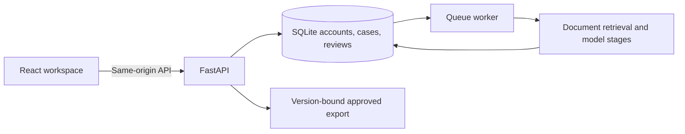

# InsureClear

Turn an Indian health-insurance denial letter and policy into an appeal draft a human can review. InsureClear brings the insurer’s explanation, the relevant policy wording, and regulatory references into one case. It keeps generated drafts separate from the exact versions approved by a reviewer.

**Release status** · Local MVP. Private pilot acceptance is open. Try the built-in fictional case first. [Pilot acceptance record](docs/PILOT_ACCEPTANCE.md)

## Start with a fictional case

Use Python 3.11 and Node.js 22 for the documented setup. The offline CI workflow tests Python 3.11 and 3.13. Docker includes Poppler, Tesseract, and Hindi OCR data. [OCR setup](docs/OCR_SETUP.md)

| What the setup touches | Where it happens |
| --- | --- |
| Dependencies | Python packages install into the project virtual environment. npm installs frontend packages into `web/frontend/node_modules`. |
| Case storage | The local backend writes account and job SQLite databases, checkpoints, and generated artifacts. Reports can retain source text even after uploaded PDFs are removed. |
| Network | When you run analysis, the server sends selected case text to the configured model provider. Local login and offline tests run without model calls. Provider keys are server-side. |
| How to stop | Stop the two local servers with Ctrl+C. Use the documented retention and deletion process for case data and backups. [Pilot operations](docs/PILOT_OPERATIONS.md) |

From the repository root in PowerShell:

```powershell
python -m venv .venv
.\.venv\Scripts\python.exe -m pip install --require-hashes -r requirements.lock
Copy-Item .env.example .env
.\.venv\Scripts\python.exe -m tools.manage_users --db data/auth.sqlite3 create --username claimant --org-id local-pilot --role claimant
```

The account command prompts for a password without echoing it. To run the fictional demo, set `LLM_PROVIDER=groq` and your authorized `GROQ_API_KEY` in `.env`. Gemini code is present and has a separate SDK migration and release-qualification gate. [Provider support boundary](docs/PILOT_OPERATIONS.md#provider-support-boundary)

In the API terminal:

```powershell
$env:INSURECLEAR_AUTH_MODE = 'accounts'
$env:INSURECLEAR_AUTH_DB = 'data/auth.sqlite3'
$env:INSURECLEAR_CORS_ORIGINS = 'http://127.0.0.1:5173'
$env:INSURECLEAR_AUTH_COOKIE_SECURE = 'false'
.\.venv\Scripts\python.exe -m uvicorn web.api:app --host 127.0.0.1 --port 8000 --no-proxy-headers
```

In a second terminal:

```powershell
Set-Location web/frontend
npm ci
npm run dev
```

Open [the local workspace](http://127.0.0.1:5173/), sign in, choose **Demo case**, and start the analysis. The demo uses fictional inputs and calls the configured provider. To exercise human approval locally, provision a separate `reviewer` in the same organization and open the case from that account.

<details>
<summary>CLI and Docker alternatives</summary>

Run the demo directly from the repository root:

```powershell
.\.venv\Scripts\python.exe orchestrator/cli.py --demo
```

The CLI also supports paired PDF inputs, paired text files, and named checkpoints. Run `orchestrator/cli.py --help` for the options. The [deployment guide](docs/DEPLOYMENT.md) covers Docker, persistent volumes, and production configuration.

</details>

## What you can inspect

- **Case analysis.** Open a fictional demo, paste a denial and policy, or upload paired PDFs. Track progress through extraction, policy analysis, regulatory checking, drafting, and model review.
- **Evidence.** Check exact policy excerpts, source offsets, regulatory versions, and any document coverage limits reported by the retrieval pipeline. See the [regulatory source inventory](docs/REGULATORY_SOURCES.md).
- **Human review.** Edit the draft, see evidence validation issues, and preserve the revision history. A reviewer records facts, coverage, and legal-applicability checks before approval. A later edit invalidates approval. The approved export serves the version and content that were reviewed.
- **Operations.** Named accounts and organization boundaries restrict case access. The backend provides bounded queue admission, progress, cooperative cancellation, confined deletion, and readiness checks. [Pilot operations](docs/PILOT_OPERATIONS.md)

<details>
<summary>Architecture and API</summary>

The browser uses the same-origin `/api` path. FastAPI authenticates the session and stores queued cases in SQLite. A single worker claims a case, runs the document and model stages, and stores a draft with source snapshots. The review API stores later versions and decisions separately.



| Routes | Purpose |
| --- | --- |
| `POST /api/auth/login`, `GET /api/auth/session`, `POST /api/auth/logout` | Create, inspect, and revoke named-account sessions |
| `POST /api/analyze`, `GET /api/jobs`, `GET /api/jobs/{id}` | Queue and inspect authorized cases |
| `GET /api/jobs/{id}/report`, `GET /api/jobs/{id}/letter` | Read generated analysis and draft text |
| `GET/PUT /api/jobs/{id}/review`, `POST /api/jobs/{id}/review/decision` | Inspect revisions, edit a draft, and record a reviewer decision |
| `GET /api/jobs/{id}/download/approved-letter` | Export the exact approved revision |
| `POST /api/jobs/{id}/cancel`, `DELETE /api/jobs/{id}` | Request cancellation or delete a case within the owner/admin boundary |
| `GET /health`, `GET /ready` | Operator liveness and configuration checks |

</details>

## Security and model controls

| Layer | Implemented controls |
| --- | --- |
| Browser | Same-origin API, memory-only CSRF state, no API keys in the bundle, and a content security policy at the hosted frontend. The Vercel preview build contains the landing page only. |
| API | Account mode by default, HTTP-only cookies with Secure enabled for HTTPS, exact Origin and CSRF checks on mutations, case ownership and organization checks, and authorization before analysis upload parsing. |
| Files and data | Bounded request bodies, PDF and OCR limits, private responses with `no-store`, and confined cleanup paths. Production storage, backup encryption, and retention need environment verification. |
| Model | Case text is treated as untrusted evidence. Provider requests separate system instructions from document text. Context and runtime budgets bound processing. Evidence validation flags or removes unsupported references and human review gates approved exports. |

Generated material is a draft for human review. The pilot requires qualified review of legal applicability and representative cases. The application prepares exports for users to review and send themselves. [Regulatory review checklist](docs/REGULATORY_REVIEW_CHECKLIST.md)

## Verification and release

Run the offline checks from the repository root:

```powershell
.\.venv\Scripts\python.exe -m pytest -q
Push-Location web/frontend
npm ci
npm test
npm run build
Pop-Location
```

The archived Groq synthetic runs on earlier commit `423c019` scored **10/10** and **8/10** on verdict accuracy. Both recorded zero unsupported claims detected by the evaluator and zero execution failures. The 8/10 run failed the strict verdict gate. Ten fictional cases do not measure performance on real claims. The final candidate requires two fresh strict runs, qualified review, capacity testing, and deployment acceptance. [Evaluation methodology](docs/EVIDENCE_FOUNDATIONS_RESULT.md) · [Pilot acceptance record](docs/PILOT_ACCEPTANCE.md)

The Vercel configuration builds a frontend-only preview from `web/frontend`. The connected pilot requires a durable FastAPI host, exact HTTPS origin configuration, and environment smoke tests. [Deployment guide](docs/DEPLOYMENT.md) · [Scaling roadmap](docs/SCALING_ROADMAP.md)
