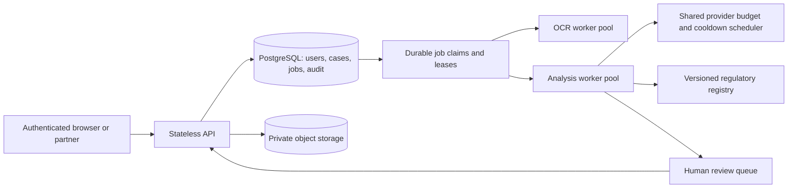

# InsureClear scaling roadmap

Date: 2026-11-05. Status: recommendations, not an approved deployment plan.
The user has not decided on target users or daily case volume yet. Stage ranges
below are planning examples rather than measured capacity commitments. Start
with a pilot and make larger infrastructure choices from observed demand. No cloud services have been provisioned.

## Measured starting point

The live ten-case short-document run passed verdict and unsupported-claim gates:
10/10 verdicts, 0 detected unsupported claims, 0 execution failures. It used
312,888 tokens and 88 successful provider calls; mean case runtime was 37.4s.
Letter-fact accuracy was 97.5%, and expected key arguments appeared in 5/7
applicable cases. See LIVE_REGRESSION_2026-11-05.md for limits and release gaps.

Those observations imply about 31,289 tokens and 8.8 calls per short synthetic
case. An illustrative 1,000 comparable cases/day would require about 31.3 million
reported tokens and 8,800 successful calls/day, before production/OCR overhead.
At 37.4s per case, one serial worker's ideal service ceiling is roughly 96
cases/hour; this is arithmetic, not a load-tested sustained throughput result.
Long documents, retries and quota waiting can reduce it substantially.

## Recommended sequence

| Stage | Build first | Evidence required before expanding |
|---|---|---|
| Private pilot, e.g. tens of cases/day | Named user accounts; ownership checks on every case/download; expert review queue; bounded document context; pinned source registry; retention and deletion controls | Correct tenant isolation, source traceability, representative case evaluation and time/cost per resolved case |
| Growing service, e.g. hundreds/day | Separate API from workers; migrate durable jobs/case metadata to PostgreSQL; object storage with short-lived signed URLs; idempotent stage jobs; queue backpressure and provider-aware admission | Burst/load tests, worker-crash recovery, no duplicate side effects, stable p95 queue-to-result latency and per-case token budgets |
| Multi-organization product, e.g. thousands/day | Tenant quotas and billing; shared provider capacity scheduler; autoscaled OCR and LLM pools; audit/event history; backups and restoration drills; per-tenant policy cache; partner APIs | Isolation testing, restore/failover drills, provider capacity agreement, representative long/OCR documents and expert-reviewed outcomes |

A simple target architecture after the pilot:

PostgreSQL row locking with SKIP LOCKED is a possible initial multi-consumer
queue, avoiding another service at first. A managed broker or Celery-based queue
is another option if routing and worker operations justify it. Either design
needs leases/heartbeats, idempotency keys, retry classification and dead-letter
handling; choosing a queue does not itself make execution exactly once.

Keep API processes stateless. Move checkpoints and final artifacts off machine
local paths before distributing workers. Namespace all job IDs, cache keys,
input fingerprints and object keys by tenant. Per-tenant quotas prevent a large
case batch from exhausting shared provider tokens for everybody else.

## The most valuable scaling work beyond infrastructure

1. **Measure outcomes:** expert acceptance, evidence errors, appeal preparation
   time, missing documents and eventual insurer response. A Judge score alone
   does not measure product success.
2. **Put a human review workflow in the product:** assign reviewers, record edits
   and reasons, approve a version, and preserve the evidence used for that version.
   Do not automatically send an appeal merely because a job completed.
3. **Reuse verified work:** cache identical public policy versions, OCR extraction
   and source indexing. Keep claimant-specific results isolated; invalidate on
   policy, prompt, extraction or regulatory version changes.
4. **Split workloads:** OCR is CPU/memory heavy; provider calls are quota/latency
   bound. Scale and queue them separately, with file/page limits and cancellation.
5. **Control cost and fairness:** per-case token/call caps, bounded revisions,
   shared organization-level provider limits and explicit queued/review states.
   More API keys in one provider organization do not create independent quota.
6. **Start with a focused customer group:** test a broker, claims-assistance team
   or benefits administrator workflow before broad self-service acquisition.
   Add batch intake, missing-document checklists and case tracking when pilot
   users show these are their bottlenecks. This is a product hypothesis.
7. **Make quality observable:** stage duration, input size, selected/omitted
   coverage, source versions, provider token usage, 429s, retries and final review
   disposition. Use synthetic/redacted diagnostics rather than document bodies.

## Decisions still needed

Target users and peak simultaneous submissions; expected document pages and
languages; turnaround goal; reviewer availability; hosting/provider budget;
data residency/retention requirements; whether users need organizations/teams.
These determine service selection and cost. None is assumed approved here.

## Sources checked

- [PostgreSQL SELECT / locking documentation](https://www.postgresql.org/docs/current/sql-select.html)
- [Groq organization-level rate limits](https://console.groq.com/docs/rate-limits)
- [S3 temporary access and integrity](https://docs.aws.amazon.com/AmazonS3/latest/userguide/using-presigned-url.html)
- [Celery task acknowledgement and idempotency](https://docs.celeryq.dev/en/stable/userguide/tasks.html)

These sources support the building blocks; the architecture and stage ranges
are recommendations based on this repository and the measured sample.
