# InsureClear: Superpowers review

Date: 2026-11-05 (Asia/Calcutta)  
Reviewed baseline: `443d837`  
Changes: local working tree; not committed or deployed.

## What the project does

InsureClear prepares a reviewable appeal package from an Indian health-insurance
claim denial and its policy. It offers a React browser interface backed by
FastAPI, a CLI, and a Streamlit interface. PDF extraction uses text extraction
with OCR fallback. The API persists jobs in SQLite and runs a background worker.

```mermaid
flowchart LR
    A[Denial and policy] --> B[Extraction and validation]
    B --> C[Auditor: case facts]
    C --> D[Policy Analyst: policy interpretation]
    D --> E[IRDAI Checker: regulatory research leads]
    E --> F[Appeal Writer: draft]
    F --> G[Judge: quality review]
    G -->|Bounded revisions| F
    G --> H[Evidence validation and correction]
    H --> I[Final draft review when changed]
    I --> J[TXT letter and JSON report]
```

The Judge's quality threshold is 0.75, with at most two ordinary quality
revisions. Evidence correction is separately bounded to two attempts followed
by deterministic sanitization. Failed final evidence checks result in
`VALIDATION_ERROR`. Regulatory output is a research lead rather than an
independently verified source. A generated letter still needs human review.

## Verified issues fixed

| Area | Reproduced problem | Resulting behavior |
|---|---|---|
| Checkpoint identity | Reusing a case ID with different documents reused prior facts and conclusions. | A versioned SHA-256 fingerprint covers the complete denial, policy, and supplied regulatory text. Changed or legacy unbound sessions are invalidated before agents read caches; identical inputs resume. |
| Session paths | The shared IO layer accepted traversal-shaped case IDs, including `..`; CLI callers bypassed API validation. | Checkpoint, output, and session-cleanup paths validate the case namespace and resolved session location. |
| Artifact downloads | The pipeline allocated a timestamped output folder twice. Crossing a clock boundary left report metadata pointing at an empty folder. | The saving function allocates once and records exactly the paths it writes. Microsecond timestamps separate rapid reruns. |
| Final quality score | Evidence correction or sanitization changed a letter after its last Judge review. | The final changed draft updates the writer checkpoint, invalidates the old Judge checkpoint, and receives a fresh scorecard. Resuming preserves the matching draft and review. |
| Evidence matching | Shorter identifiers, amounts, and clauses matched prefixes of longer source values. | Reference boundaries reject examples such as `POL-123` versus `POL-1234`, `POL-123-9`, or `POL-123/9`; `INR 1000` versus `INR 10000`; and `4.2` versus `4.20` or `4.2.1`. |
| Long documents | Auditor prompts silently stopped at 4,000 characters; policy analysis stopped at 5,000. | Complete accepted source documents reach these agents. Provider context limits can still cause an explicit failure; bounded chunking remains a recommended improvement. |
| Groq key selection | When every key was cooling down, the client waited for the earliest expiry but could select a different key. | It waits for and selects the same earliest-available key. |
| Groq retry units | A response saying `45 milliseconds` produced a 45.1-second delay. | `ms`, `millisecond`, and `milliseconds` consistently produce a 0.145-second delay, including the existing safety margin. |
| Queue recovery | Merely opening another JobStore requeued a job that was still running. | Construction only initializes schema. A Windows/POSIX process lock covers recovery, execution, and upload cleanup. Standby API workers retry ownership and recover existing jobs when the owner exits. |

Legacy checkpoint invalidation means the next run of an old named case may
recompute its stages. Sending complete documents and reviewing an
evidence-corrected final draft can increase provider usage and runtime.

## Verification evidence

- Original backend baseline: **34 passed**.
- Final full discovered backend suite: **62 passed**; 28 added regression cases.
- Command: `.venv\Scripts\python.exe -B -m pytest -q -p no:cacheprovider`.
- Frontend: `npm run build` passed during this review; frontend source was unchanged.
- Regression tests were run before implementation and reproduced the targeted
  failures. Additional checks cover identical-input resume, changed sources,
  legacy checkpoints, corrected-letter resume, worker ownership, and takeover.
- Independent read-only review found no remaining blockers in the changed scope.
- `git diff --check` is part of final validation.

Provider calls in these tests are replaced with deterministic test responses.
This review did **not** rerun the paid/live ten-case provider evaluation, measure
production latency, verify legal rules, or perform browser interaction testing.
Windows locking was executed; the POSIX branch was reviewed but not executed.

## Recommended next work

1. **Rerun the strict live evaluation on these changes.** Complete-document prompts
   and final draft review change model inputs and call counts. Record extraction,
   verdict, unsupported-claim, runtime, and rate-limit results against the release
   commit before treating the previous live baseline as current.
2. **Add token-aware document chunking or retrieval.** Complete inputs now reach
   the agents, but very large documents may exceed a provider's context or quota.
   Retrieve relevant clauses with source locations and report incomplete coverage.
3. **Strengthen evidence semantics.** Prefix checks are improved, but regex
   validation cannot establish that an insurer name, diagnosis, amount, or medical
   assertion belongs to the right claim. Add canonical fact comparison and pass
   a complete source evidence map to the Judge.
4. **Version and verify regulatory sources.** Store exact documents, effective
   dates, clause locations, and applicability metadata; keep generated regulatory
   analysis separate from verified evidence.
5. **Harden public deployment.** The frontend's `VITE_API_KEY` is embedded in its
   JavaScript bundle and cannot serve as a private user credential. Use server
   authentication and per-user case authorization for a public service. Add
   request cancellation, retention policies, redacted diagnostics, and operational
   health checks. SQLite plus a local process lock remains a single-host design;
   distributed deployments need a shared queue and suitable ownership semantics.

## Superpowers installation

All 15 skill directories from `obra/superpowers` were installed with Codex's
skill-installer into `C:/Users/Harsh Jain/.codex/skills`. They are available for
native discovery on the next turn. This review explicitly loaded the relevant
skills during the current turn: using-superpowers, requesting-code-review,
systematic-debugging, test-driven-development, and
verification-before-completion.
